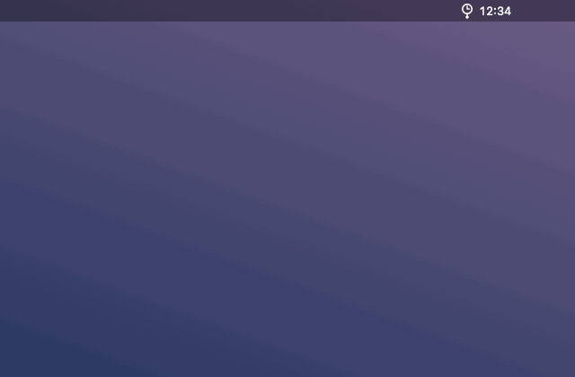

# Pull Timer

A macOS menu bar timer you set by pulling its icon. The further you pull, the longer the timer.



*One timer running while a second is set with Option held. The animation is rendered by the app's own drawing code over a mock desktop.*

## Use

- **Set a timer:** drag the menu bar icon in any direction. The label next to the icon shows the duration and when it will ring. Release to start.
- **Stops:** 30 s, 1, 2, 3, 5, 7, 10, 15, 20, 30, 45, 60 and 90 min, then 2, 3, 4, 6, 8, 12 and 24 h. Each stop is 28 points of pull.
- **Timer 2:** hold Option while pulling to set a second, independent timer.
- **Cancel:** pull a short distance and release inside the dead zone, or use the menu.
- **Menu:** click or right-click the icon. It has cancel, restore of a cancelled or replaced timer, a log of recent events, a toggle for scale marks along the pull line, and launch at login.
- **Time's up:** a chime, a notification, and a blinking "Time's up" in the menu bar until you click it.

The log is written to `~/Library/Logs/PullTimer.log`.

## Build

Requires macOS 13 or later and the Xcode command line tools.

```sh
./build.sh
open "build/Pull Timer.app"
```

The app is a single Swift file with no dependencies. `build.sh` compiles it, generates the app icon, and ad-hoc signs the bundle. It is not notarized, so a copy downloaded from elsewhere needs "Open Anyway" in System Settings → Privacy & Security on first launch. Building it yourself avoids that.
