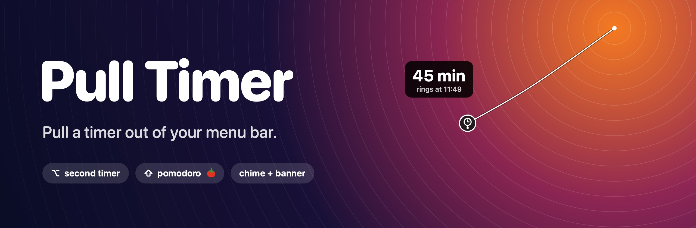
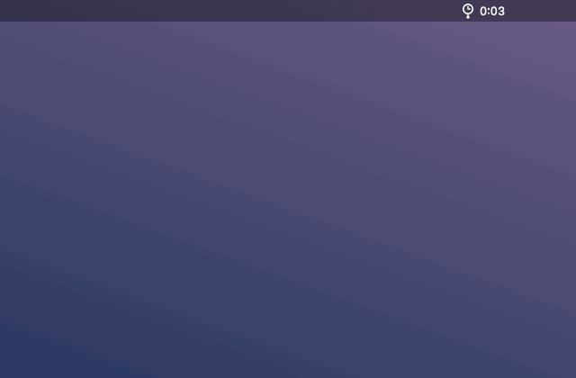

# Pull Timer

A macOS menu bar timer you set by pulling its icon. The further you pull, the longer the timer.

**[Download the latest release](https://github.com/OlofMoriya/pull-timer/releases/latest)** (Apple Silicon and Intel, macOS 13 or later), or build it yourself below.

## Pull to set


- **Set a timer:** drag the menu bar icon in any direction. The label next to the icon shows the duration and when it will ring. Release to start.
- **Stops:** 30 s, 1, 2, 3, 5, 7, 10, 15, 20, 30, 45, 60 and 90 min, then 2, 3, 4, 6, 8, 12 and 24 h. Each stop is 28 points of pull.
- **Timer 2:** hold Option while pulling to set a second, independent timer.
- **Cancel:** pull a short distance and release inside the dead zone, or use the menu.

## Pomodoro


- **Start:** hold Shift while pulling. The pull sets the focus length (15 to 90 min), the break is a fifth of it and the long break three fifths. "Start pomodoro" in the menu repeats the last one.
- **Cycle:** focus and breaks alternate by themselves, with a long break after every fourth focus. The menu bar icon turns into a tomato (red during focus, outlined during breaks) next to "focus" or "break" and the countdown.
- **Adjust:** "Pomodoro settings" in the menu sets the focus, break and long break lengths and the number of focus rounds before a long break. A change applies from the next phase.
- **Stop:** from the menu, or by pulling a new timer 1.

## Time's up



When a timer finishes you get a chime, a notification, a banner in the middle of the screen above other windows, and a blinking "Time's up" in the menu bar. Click the banner or the icon to dismiss. The banner can be turned off in the menu.

## Menu

Click or right-click the icon. The menu has cancel, restore of a cancelled or replaced timer, a log of recent events, pomodoro settings, a toggle for scale marks along the pull line, and launch at login.

The log is written to `~/Library/Logs/PullTimer.log`.

## Build

Requires macOS 13 or later and the Xcode command line tools.

```sh
./build.sh
open "build/Pull Timer.app"
```

The app is a single Swift file with no dependencies. `build.sh` compiles it, generates the app icon, and ad-hoc signs the bundle. It is not notarized, so a copy downloaded from elsewhere needs "Open Anyway" in System Settings → Privacy & Security on first launch. Building it yourself avoids that.

The banner and animations above are rendered by the app's own drawing code over a mock desktop, not screen recordings.
